<div align="center">


# 🎬 FilmTeca

**Descubre, valora y guarda tus películas favoritas.**
Una aplicación web full-stack, pensada primero para el móvil y totalmente adaptada a escritorio.

[](https://filmteca.netlify.app)


[Demo](https://filmteca.netlify.app) · [Funcionalidades](#-funcionalidades) · [Capturas](#-capturas) · [Instalación](#-puesta-en-marcha) · [API](#-referencia-de-la-api) · [Autor](#-autor)

</div>

---

## 📖 Sobre el proyecto

**FilmTeca** es un catálogo colaborativo de cine. Cualquier visitante puede explorar películas, buscarlas y leer reseñas; los usuarios registrados pueden **puntuarlas del 1 al 10**, escribir su opinión y guardar sus **favoritas**; y los perfiles con permisos de gestión pueden **ampliar y mantener el catálogo** (películas, actores, directores, géneros y premios).

El proyecto está dividido en dos aplicaciones independientes:

| Parte | Carpeta | Descripción |
| --- | --- | --- |
| 🖥️ **Frontend** | [`filmteca-frontend/`](filmteca-frontend) | SPA en React, diseño *mobile-first* con modo oscuro |
| ⚙️ **Backend** | [`backend-filmteca/`](backend-filmteca) | API REST en NestJS + TypeORM + PostgreSQL |

> ⏳ **Nota sobre la demo:** el backend está alojado en un plan gratuito que se "duerme" por inactividad. La primera carga puede tardar un par de minutos; la propia aplicación te avisa mientras despierta.

---

## ✨ Funcionalidades

### 🍿 Para todos los visitantes
- **Catálogo paginado** (16 películas por página) con póster, año y nota media.
- **Búsqueda** por título y por año de estreno.
- **Navegación por género** desde el menú superior.
- **Ficha completa de cada película**: sinopsis, duración, país, reparto, directores, géneros, premios, música, fotografía y todas las reseñas con sus estrellas.
- **Menú lateral desplegable** con acceso rápido a géneros, valoraciones, favoritos y gestión, según tu rol.
- **Modo claro / oscuro**: respeta la preferencia del sistema y se puede cambiar con un botón.
- **Diseño responsive** pensado para móvil (puntos de corte en 768 px y 480 px), incluidas las tablas de administración.
- Manifiesto de aplicación web (`manifest.json`) para añadirla a la pantalla de inicio.

### 👤 Para usuarios registrados (`USER`)
- Registro e inicio de sesión con **JWT**.
- **Valorar películas** con un selector de 10 estrellas y reseña opcional, sobre un fondo desenfocado con el póster.
- **Favoritos**: marca o desmarca una película con el corazón y consulta tu lista.
- **Historial de valoraciones** personales.
- **Perfil**: editar tus datos o dar de baja tu cuenta.

### 🛠️ Para gestores del catálogo (`SUPERUSER` y `ADMIN`)
- `SUPERUSER`: dar de alta películas (con selección múltiple de géneros, directores, actores y premios), crear actores y directores sobre la marcha y **cambiar el póster** de una película.
- `ADMIN`: editar y eliminar contenido, gestionar géneros y premios y **activar / desactivar usuarios** desde el panel de gestión (en móvil, la tabla se transforma en tarjetas). El menú **Gestión** da acceso a Películas, Géneros, Actores, Directores, Premios, Valoraciones y Usuarios.

> Los permisos se aplican **en ambos lados**: el frontend protege las rutas con `ProtectedRoute` y el backend lo vuelve a comprobar con guards de JWT y roles.

## 📸 Capturas

### 📱 Versión móvil

La aplicación está diseñada pensando primero en el móvil.

<div align="center">
<table>
  <tr>
    <td align="center">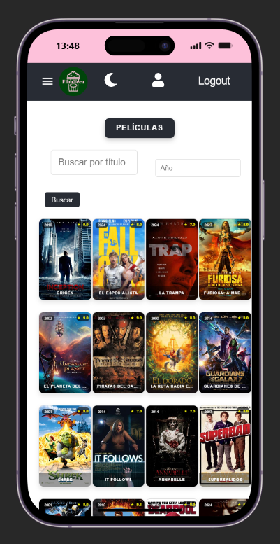<br/><sub><b>Catálogo</b><br/>búsqueda, nota media y año</sub></td>
    <td align="center">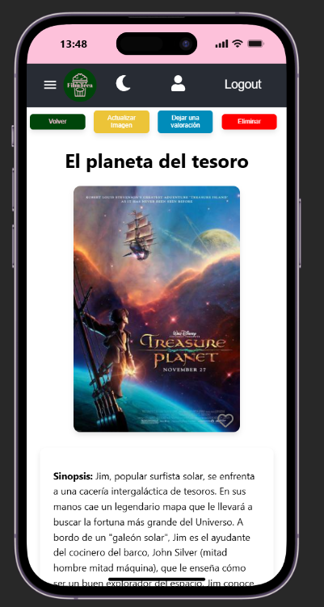<br/><sub><b>Ficha de película</b><br/>sinopsis, reparto y acciones</sub></td>
    <td align="center">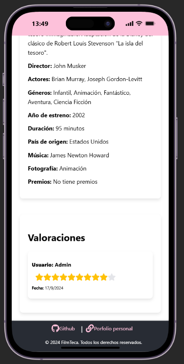<br/><sub><b>Datos y reseñas</b><br/>valoraciones de los usuarios</sub></td>
    <td align="center">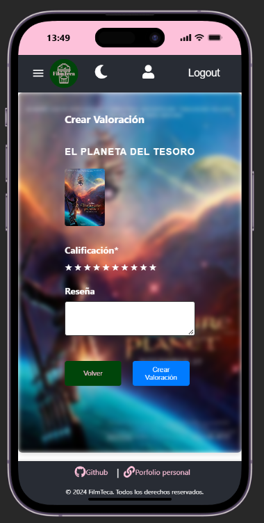<br/><sub><b>Valorar</b><br/>puntuación de 1 a 10 y reseña</sub></td>
  </tr>
  <tr>
    <td align="center">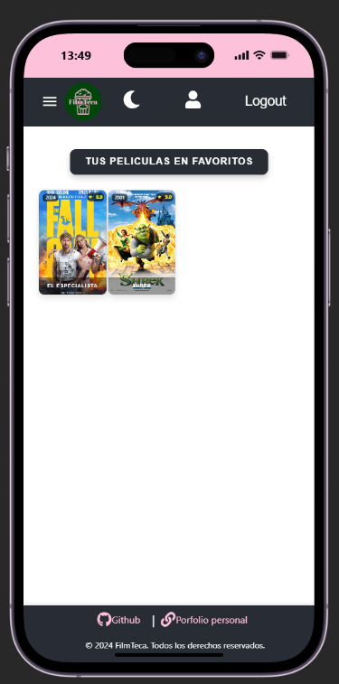<br/><sub><b>Favoritos</b><br/>tu lista personal</sub></td>
    <td align="center">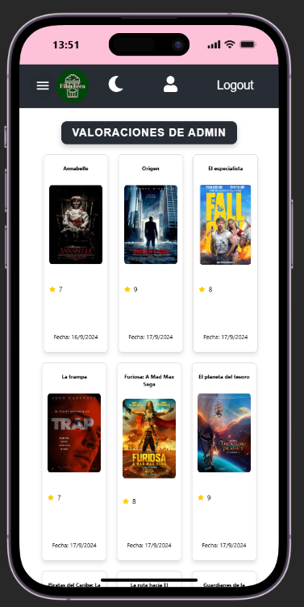<br/><sub><b>Mis valoraciones</b><br/>historial con nota y fecha</sub></td>
    <td align="center">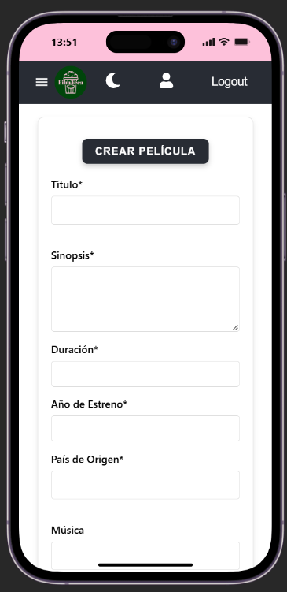<br/><sub><b>Crear película</b><br/>formulario de alta</sub></td>
    <td align="center">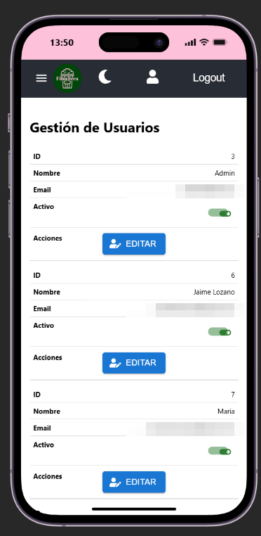<br/><sub><b>Gestión de usuarios</b><br/>la tabla se convierte en tarjetas</sub></td>
  </tr>
</table>
</div>

### 🖥️ Versión escritorio (modo oscuro)

<div align="center">
  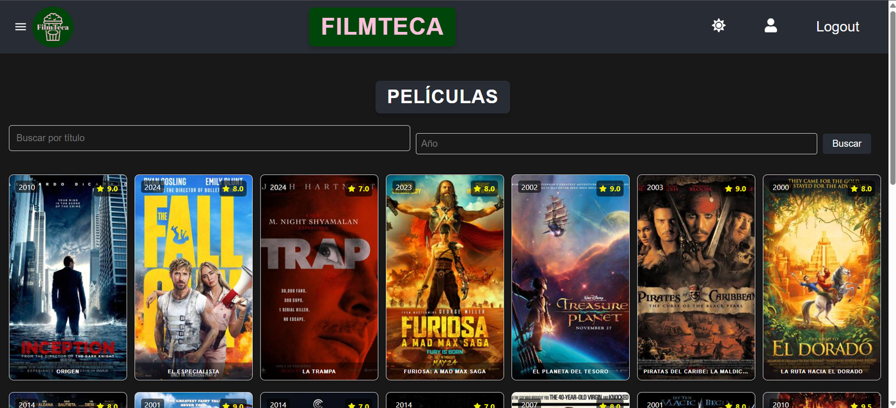
</div>

<details>
<summary><b>Ver más capturas de escritorio</b></summary>
<br/>

<table>
  <tr>
    <td align="center" width="50%">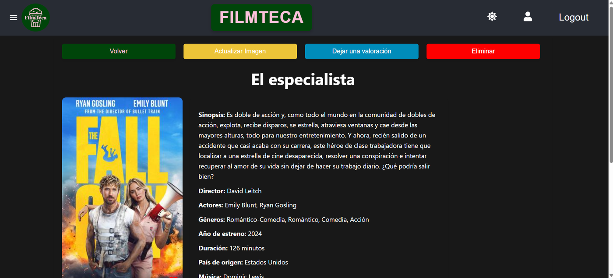<br/><sub><b>Ficha de película</b></sub></td>
    <td align="center" width="50%">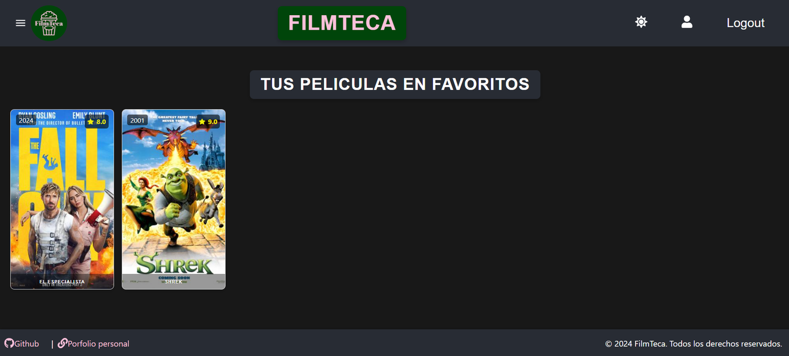<br/><sub><b>Favoritos</b></sub></td>
  </tr>
  <tr>
    <td align="center">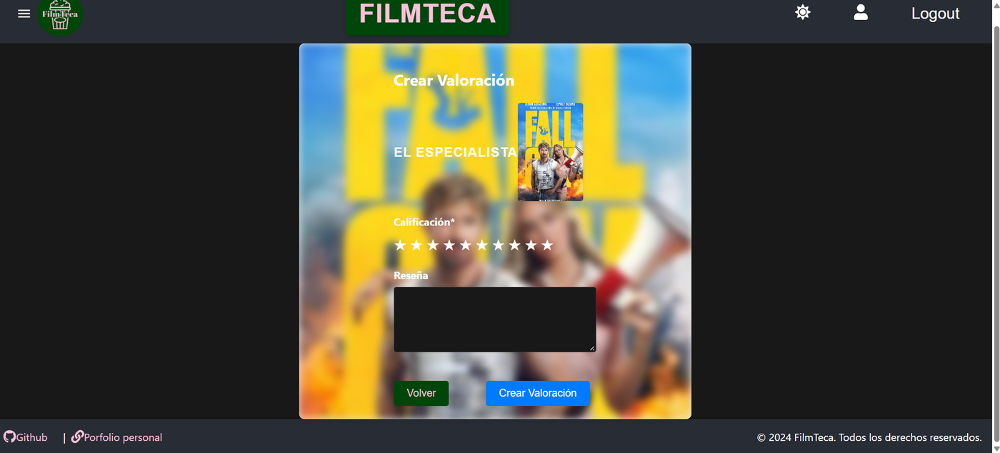<br/><sub><b>Crear valoración</b></sub></td>
    <td align="center">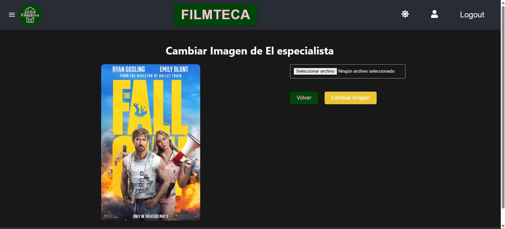<br/><sub><b>Cambiar el póster</b></sub></td>
  </tr>
  <tr>
    <td align="center">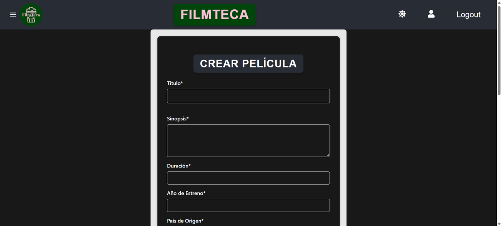<br/><sub><b>Crear película</b></sub></td>
    <td align="center">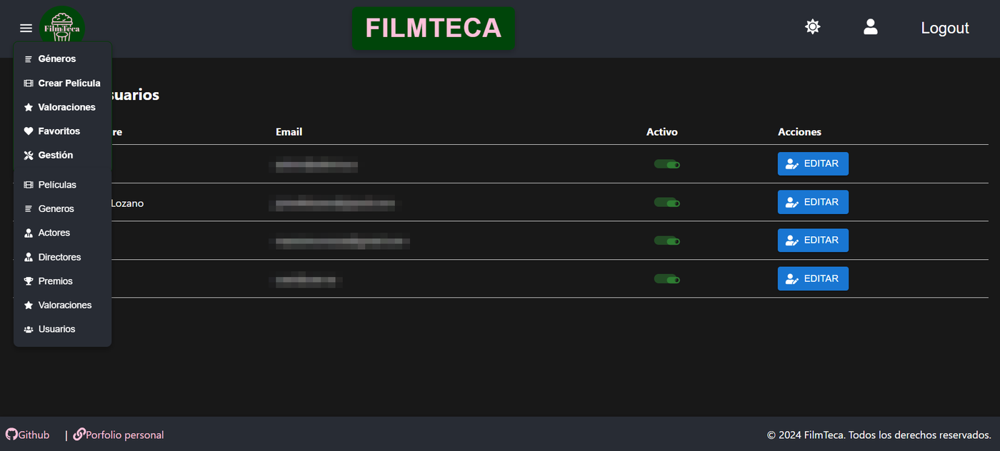<br/><sub><b>Gestión de usuarios y menú de administración</b></sub></td>
  </tr>
  <tr>
    <td align="center" colspan="2">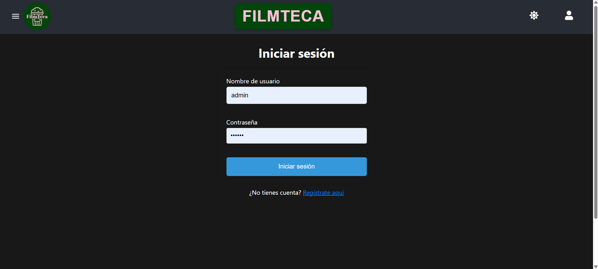<br/><sub><b>Inicio de sesión</b></sub></td>
  </tr>
</table>

</details>

> 🌓 Las capturas de móvil están en **modo claro** y las de escritorio en **modo oscuro**; la aplicación ofrece ambos en cualquier dispositivo.

---

## 🧰 Tecnologías

<table>
<tr>
<td valign="top" width="50%">

### Frontend
- **React 18** (Create React App)
- **React Router 6** para el enrutado
- **Axios** para las peticiones HTTP
- **Material UI 6** (menús, switches, botones)
- **React Icons** y **Font Awesome**
- **React Select** (selectores múltiples)
- **React Toastify** (notificaciones)
- **js-cookie** + **jwt-decode** (sesión)
- Desplegado en **Netlify**

</td>
<td valign="top" width="50%">

### Backend
- **NestJS 10** con **TypeScript**
- **TypeORM** + **PostgreSQL**
- **Passport** + **JWT** (HS512)
- **bcryptjs** para el hash de contraseñas
- **class-validator** / **class-transformer**
- **nestjs-paginate** (paginación, búsqueda y filtros)
- **cache-manager** (caché de consultas)
- **Cloudinary** + **Multer** (imágenes)
- Desplegado en **Render**

</td>
</tr>
</table>

---

## 🏗️ Arquitectura

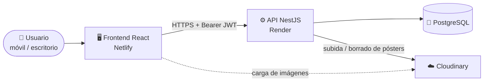

### Modelo de datos

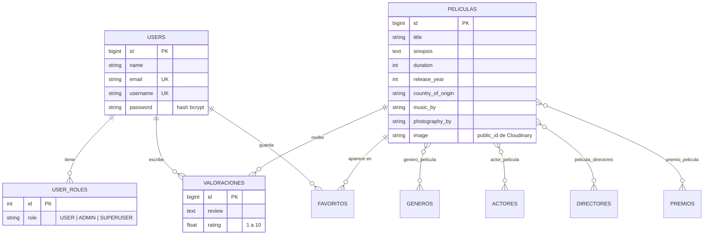

> 🗑️ **Borrado lógico:** películas, actores, directores, premios, valoraciones y usuarios no se eliminan físicamente; se marcan con `deleted_at`.

### Roles y permisos

Cada usuario puede tener uno o varios roles y los permisos se comprueban **por rol** (no son jerárquicos).

| Acción | Visitante | `USER` | `SUPERUSER` | `ADMIN` |
| --- | :---: | :---: | :---: | :---: |
| Ver películas, géneros, reparto y reseñas | ✅ | ✅ | ✅ | ✅ |
| Valorar películas y gestionar favoritos | ❌ | ✅ | ❌ | ❌ |
| Gestionar su propio perfil | ❌ | ✅ | ❌ | ❌ |
| Crear películas, actores y directores | ❌ | ❌ | ✅ | ❌ |
| Cambiar el póster de una película | ❌ | ❌ | ✅ | ❌ |
| Editar / eliminar películas, actores y directores | ❌ | ❌ | ❌ | ✅ |
| Crear, editar y eliminar géneros y premios | ❌ | ❌ | ❌ | ✅ |
| Gestionar usuarios | ❌ | ❌ | ❌ | ✅ |

> 💡 Como los roles se suman, una cuenta de gestión que también quiera valorar películas necesita tener además el rol `USER`.

---

## 🚀 Puesta en marcha

### Requisitos previos

- [Node.js](https://nodejs.org/) 18 o superior y npm
- [PostgreSQL](https://www.postgresql.org/) en local o en la nube
- Una cuenta gratuita de [Cloudinary](https://cloudinary.com/) para las imágenes

### 1. Clonar el repositorio

```bash
git clone https://github.com/jaime9lozano/FilmTeca.git
cd FilmTeca
```

### 2. Backend

```bash
cd backend-filmteca
npm install
```

Crea un archivo `.env` en `backend-filmteca/` (está en el `.gitignore`, nunca lo subas al repositorio):

```env
# --- JWT ---
TOKEN_SECRET=pon_aqui_un_secreto_largo_y_aleatorio
TOKEN_EXPIRES=3600                 # duración del token en segundos

# --- Cloudinary ---
CLOUDINARY_CLOUD_NAME=tu_cloud_name
CLOUDINARY_API_KEY=tu_api_key
CLOUDINARY_API_SECRET=tu_api_secret

# --- Base de datos ---
DB_TYPE=postgres
DB_HOST=localhost
DB_PORT=5432
DB_USERNAME=postgres
DB_PASSWORD=tu_contraseña
DB_NAME=filmteca
DB_SYNCHRONIZE=true                # crea las tablas automáticamente (solo en desarrollo)
DB_AUTOLOAD_ENTITIES=true
```

Crea la base de datos vacía (`CREATE DATABASE filmteca;`) y arranca el servidor:

```bash
npm run start:dev
```

La API quedará escuchando en **http://localhost:8000**.

### 3. Frontend

En otra terminal:

```bash
cd filmteca-frontend
npm install
npm start
```

La aplicación se abrirá en **http://localhost:3000**. En desarrollo apunta automáticamente a `http://localhost:8000`; en producción usa la URL del backend desplegado.

### 4. Crear tu primer administrador

El registro desde la web crea siempre cuentas con rol `USER`. Para convertir una cuenta en gestora, regístrate normalmente y añade el rol directamente en la base de datos:

```sql
-- Sustituye 1 por el id de tu usuario
INSERT INTO user_roles (role, user_id) VALUES ('ADMIN', 1);
INSERT INTO user_roles (role, user_id) VALUES ('SUPERUSER', 1);
```

Después, vuelve a iniciar sesión para que el token incluya los nuevos roles.

> 🎞️ **Para empezar a rellenar el catálogo:** crea primero algunos **géneros** (rol `ADMIN`); después podrás dar de alta películas desde *Crear película* (rol `SUPERUSER`).

### ⚙️ Personalizar para tu propio despliegue

Si haces un fork y lo despliegas con tus propios servicios, revisa estos puntos:

| Qué | Dónde |
| --- | --- |
| URL del backend en producción (`https://filmteca.onrender.com`) | Constante `baseURL` en los componentes de `filmteca-frontend/src/components/` |
| *Cloud name* de Cloudinary (`dj0fdyymb`) en las URLs de imágenes | Constante `cloudinaryURL` en los mismos componentes |
| Orígenes permitidos por CORS | [`backend-filmteca/src/config/cors/cors.module.ts`](backend-filmteca/src/config/cors/cors.module.ts) |
| Puerto de la API (`8000`) | [`backend-filmteca/src/main.ts`](backend-filmteca/src/main.ts) |
| Redirección de la SPA en Netlify | `filmteca-frontend/public/_redirects` |

### 📜 Scripts disponibles

<details>
<summary><b>Backend</b> (<code>backend-filmteca</code>)</summary>

| Comando | Descripción |
| --- | --- |
| `npm run start:dev` | Servidor en modo desarrollo con recarga automática |
| `npm run build` | Compila el proyecto a `dist/` |
| `npm run start:prod` | Ejecuta la versión compilada |
| `npm run lint` | Analiza y corrige el código con ESLint |
| `npm run format` | Formatea el código con Prettier |
| `npm test` / `npm run test:e2e` | Tests unitarios / de extremo a extremo (Jest) |

</details>

<details>
<summary><b>Frontend</b> (<code>filmteca-frontend</code>)</summary>

| Comando | Descripción |
| --- | --- |
| `npm start` | Servidor de desarrollo en el puerto 3000 |
| `npm run build` | Genera la versión de producción en `build/` |
| `npm test` | Lanza los tests con React Testing Library |

</details>

---

## 🗺️ Rutas del frontend

| Ruta | Acceso | Descripción |
| --- | --- | --- |
| `/` | Público | Catálogo con búsqueda y paginación |
| `/pelicula/:id` | Público | Ficha de la película y sus reseñas |
| `/genero/:id` | Público | Películas de un género |
| `/login` · `/register` | Público | Acceso y registro |
| `/user` | `USER` | Perfil del usuario |
| `/userValoraciones/:id` | `USER` | Mis valoraciones |
| `/userFavoritos/:id` | `USER` | Mis favoritas |
| `/createValoracion/:id` | `USER` | Valorar una película |
| `/createPelicula` | `SUPERUSER` | Dar de alta una película |
| `/cambiarImagen/:id` | `SUPERUSER` | Cambiar el póster |
| `/admin/usuarios` | `ADMIN` | Gestión de usuarios |
| `/forbidden` | — | Pantalla de acceso denegado (403) |

---

## 📡 Referencia de la API

URL base en local: `http://localhost:8000`. Las rutas protegidas requieren la cabecera `Authorization: Bearer <access_token>`.

<details>
<summary><b>🔐 Autenticación</b></summary>

| Método | Endpoint | Acceso | Descripción |
| --- | --- | --- | --- |
| `POST` | `/auth/register` | Público | Registra un usuario y devuelve `{ access_token }` |
| `POST` | `/auth/login` | Público | Inicia sesión y devuelve `{ access_token }` |

La contraseña debe tener **al menos 8 caracteres, una mayúscula, una minúscula y un número**.

```json
// POST /auth/register
{
  "name": "Ada Lovelace",
  "username": "ada",
  "email": "ada@example.com",
  "password": "Secreta123"
}
```

</details>

<details>
<summary><b>🎞️ Películas</b></summary>

| Método | Endpoint | Acceso | Descripción |
| --- | --- | --- | --- |
| `GET` | `/peliculas` | Público | Listado paginado (16 por página) |
| `GET` | `/peliculas/:id` | Público | Detalle con géneros, actores, directores y premios |
| `POST` | `/peliculas` | `SUPERUSER` | Crea una película |
| `PUT` | `/peliculas/:id` | `ADMIN` | Actualiza una película |
| `DELETE` | `/peliculas/:id` | `ADMIN` | Elimina (borrado lógico) |
| `PATCH` | `/peliculas/:id/imagen` | `SUPERUSER` | Cambia el póster (`multipart/form-data`, campo `file`; jpg, jpeg, png o gif) |

Parámetros del listado, con la sintaxis de `nestjs-paginate`:

```
GET /peliculas?page=2&search=matrix&sortBy=release_year:DESC&filter.release_year=$gte:2000
```

</details>

<details>
<summary><b>🏷️ Géneros, actores, directores y premios</b></summary>

| Recurso | Listar / ver | Crear | Editar / eliminar |
| --- | --- | --- | --- |
| `/generos` | Público | `ADMIN` | `ADMIN` |
| `/actores` | Público | `SUPERUSER` | `ADMIN` |
| `/directores` | Público | `SUPERUSER` | `ADMIN` |
| `/premios` | Público | `ADMIN` | `ADMIN` |

Además: `GET /generos/:id/peliculas` devuelve las películas de un género (paginado).

</details>

<details>
<summary><b>⭐ Valoraciones</b></summary>

| Método | Endpoint | Acceso | Descripción |
| --- | --- | --- | --- |
| `GET` | `/valoraciones` | Público | Todas las valoraciones (paginado) |
| `GET` | `/valoraciones/:id` | Público | Una valoración |
| `GET` | `/valoraciones/:id/pelicula` | Público | Valoraciones de una película |
| `GET` | `/valoraciones/:id/user` | Público | Valoraciones de un usuario |
| `POST` | `/valoraciones` | `USER` | Crea una valoración (`rating` de 1 a 10, `review` opcional) |
| `PUT` | `/valoraciones/:id` | `USER` | Actualiza una valoración |
| `DELETE` | `/valoraciones/:id` | `USER` | Elimina una valoración |

</details>

<details>
<summary><b>❤️ Favoritos</b> (rol <code>USER</code>)</summary>

| Método | Endpoint | Descripción |
| --- | --- | --- |
| `GET` | `/favoritos/es-favorita?userId=&peliculaId=` | Indica si una película es favorita |
| `GET` | `/favoritos/user/:userId` | Favoritas de un usuario |
| `POST` | `/favoritos/add` | Añade una favorita (`{ userId, peliculaId }`) |
| `DELETE` | `/favoritos/remove` | Quita una favorita (`{ userId, peliculaId }`) |

</details>

<details>
<summary><b>🙍 Usuarios</b></summary>

| Método | Endpoint | Acceso | Descripción |
| --- | --- | --- | --- |
| `GET` | `/users` | `ADMIN` | Lista de usuarios |
| `GET` | `/users/:id` | `ADMIN` | Un usuario |
| `POST` | `/users` | `ADMIN` | Crea un usuario |
| `PUT` | `/users/:id` | `ADMIN` | Actualiza o activa / desactiva un usuario |
| `GET` | `/users/me/profile` | `USER` | Mi perfil |
| `PUT` | `/users/me/profile` | `USER` | Actualiza mi perfil |
| `DELETE` | `/users/me/profile` | `USER` | Da de baja mi cuenta |

</details>

---

## 📁 Estructura del proyecto

```
FilmTeca/
├── backend-filmteca/              # API REST (NestJS)
│   ├── src/
│   │   ├── config/                # Cloudinary y CORS
│   │   ├── rest/
│   │   │   ├── auth/              # Registro, login, JWT y guards de roles
│   │   │   ├── users/             # Usuarios y roles
│   │   │   ├── peliculas/         # CRUD, búsqueda y paginación
│   │   │   ├── generos/  actor/  director/  premio/
│   │   │   ├── valoracion/        # Puntuaciones y reseñas
│   │   │   ├── favorito/          # Películas favoritas
│   │   │   └── storage/           # Subida de imágenes a Cloudinary
│   │   ├── app.module.ts
│   │   └── main.ts
│   └── test/                      # Tests e2e
│
└── filmteca-frontend/             # Aplicación web (React)
    ├── public/                    # Logos, manifest.json, sitemap y _redirects
    └── src/
        ├── components/
        │   ├── admin/             # Panel de administración
        │   ├── peliculas/         # Listado, detalle, alta y géneros
        │   ├── valoracion/        # Formulario y estrellas
        │   ├── favoritos/  usuario/  login/  imagen/
        │   └── header/  footer/  errores/
        ├── AuthContext.js         # Estado de sesión (JWT en cookie)
        ├── ProtectedRoute.js      # Rutas protegidas por rol
        └── App.js                 # Rutas y modo oscuro
```

---

## 🧭 Hoja de ruta

- [ ] Completar las pantallas del panel de administración de películas, géneros, actores, directores, premios y valoraciones (las rutas ya existen).
- [ ] Edición de usuarios desde el panel de gestión.
- [ ] Editar y borrar las propias reseñas desde la interfaz (la API ya lo soporta).
- [ ] Documentación interactiva de la API con Swagger.
- [ ] Ampliar la cobertura de tests.

---

## 👨‍💻 Autor

**Jaime Lozano**

[](https://github.com/jaime9lozano)
[](https://portfolio-jaime-lozano.netlify.app/)

---

<div align="center">

© 2024 FilmTeca. Todos los derechos reservados.

Hecho con 🍿 y mucho cine.

</div>
